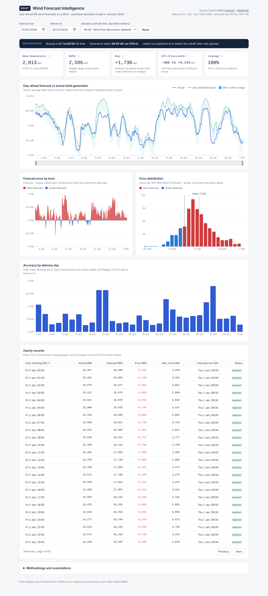

# REint | Wind Forecast Intelligence

A pilot web app for a UK utility's day-ahead procurement team. For every delivery hour bought in January 2026, it shows which national wind forecast was actually available when the purchase was made. It then measures how far that forecast was from what the wind delivered.

**Live app:** _not yet deployed_ (see [Deployment](#deployment))



_Screenshot of the running app against live Elexon data. Taken in a sandbox where Google Fonts was blocked, so it uses the fallback font._

## The problem

The team buys power in the GB day-ahead market on the day before delivery (D-1). Whatever wind does not deliver has to be bought from other sources, so they plan around a wind forecast. The analysis answers two questions:

1. What was the latest wind forecast available at the moment of each January 2026 purchase decision?
2. How accurate were those forecasts, so that future decisions can allow for the error?

Scope is national GB wind only, from two Elexon BMRS datasets: actuals from FUELHH and forecasts from WINDFOR. No price data is used, so the app does not estimate cost or savings.

## What the January data shows

With the default 09:50 cutoff, across 744 delivery hours (2 Jan – 1 Feb):

- All 744 hours matched.
- Mean absolute error was 2,013 MW and RMSE 2,506 MW.
- Bias was +1,730 MW: the day-ahead forecast was above actual output on 28 of 31 days.
- The error was between −489 and +4,144 MW in 80% of hours.

These are the app's live outputs at the time of writing, not hard-coded figures. The cause of the bias can't be established from these two datasets; possibilities include differences in which wind farms each dataset covers, or curtailment.

## Features

- **Decision cutoff selector:** 09:20, 09:50 (default) or 15:30 UK time on D-1. Every metric is recomputed using only forecasts published by that cutoff.
- **KPIs:** MAE, RMSE, bias, 80% error range and coverage. Each has a tooltip explaining what it means.
- **Forecast vs actual chart:** includes an optional 80% outturn range, a zoom brush and click-to-inspect for a single hour.
- **Error charts:** signed hourly error (over- and under-forecasts coloured differently), an error histogram with the mean marked, and daily MAE with incomplete days flagged.
- **Hourly records table:** sortable, with the forecast run used for each hour and its matching status.
- **Methodology panel:** sources, selection rule, cutoff, sign convention, metric definitions and treatment of missing data.
- **Clear data states:** explicit loading, error, empty and partial-data views. An Elexon outage is shown as an error, never as an empty month.

## Methodology

### Data (verified against the live API and its OpenAPI spec)

| | FUELHH (actual) | WINDFOR (forecast) |
|---|---|---|
| Endpoint | `/datasets/FUELHH/stream?settlementDateFrom&settlementDateTo&fuelType=WIND` | `/datasets/WINDFOR/stream?publishDateTimeFrom&publishDateTimeTo` |
| Resolution | 30 min, "average MW over 30 minutes" | 1 hour (start times on the hour only) |
| Key fields | `startTime`, `generation`, `publishTime`, `settlementDate`, `settlementPeriod` | `startTime`, `publishTime`, `generation` |
| Timestamps | UTC, ISO 8601 with `Z` | UTC, ISO 8601 with `Z` |
| Jan 2026 profile | 1,488 rows, no gaps, duplicates or nulls | 264 runs, ~8 a day, 73 hourly values each, no duplicates or nulls |

In January, WINDFOR runs were published at 02:30, 04:30, 07:30, 09:30, 11:30, 15:30, 18:30 and 22:30 UTC, plus one off-schedule run at 12:25. The spec text lists these one hour later; the app uses the recorded `publishTime`, not the documented schedule.

### Forecast selection (`backend/app/analytics/selection.py`)

For each delivery hour on UK day D:

1. **Compute the cutoff.** It is the configured cutoff time on D-1, set in `Europe/London` and converted to UTC, so it stays correct across clock changes.
2. **Choose the forecast.** Use the latest run with `publishTime ≤ cutoff` that has a non-null value for that hour.
3. **Never use later runs**, even when they would be more accurate. Hours with no eligible run are reported as `no_eligible_forecast`.
4. **Resolve conflicts deterministically.** If one run held two different values for the same hour, the higher is kept, whatever the input order, and the conflict is counted. None occurred in January.

**Why 09:50 is the default.** It is the [Nord Pool GB day-ahead auction](https://support.nordpoolgroup.com/support/solutions/articles/8000088463-about-the-day-ahead-gb-auction) gate closure. EPEX's GB auctions at 09:20 (hourly) and 15:30 (half-hourly) are offered as alternatives. In January, a 09:50 cutoff selects the D-1 09:30 run for every hour, and 09:20 selects the 07:30 run.

**How the cutoff changes the results.** A later cutoff uses a fresher run, so errors shrink: MAE is 2,039 MW at 09:20, 2,013 MW at 09:50 and 1,873 MW at 15:30. Comparing against a more recent forecast than the team actually had would make the forecast look better than it was in practice.

### Period

"Purchase decisions made in January 2026" is read literally. Decisions on 1–31 January are for delivery days **2 January – 1 February**: 31 UK days, 744 hours. If you'd rather analyse delivery days 1–31 January, set `DELIVERY_FIRST_DAY` and `DELIVERY_LAST_DAY` accordingly. The expected hours are generated by stepping in UTC between UK local midnights, so 23- and 25-hour clock-change days come out right (this is tested).

### Hourly alignment

WINDFOR is hourly, so each forecast hour is compared with the mean of FUELHH's two half-hours in that hour, i.e. hourly average MW. An hour with only one half-hour present counts as having no actual.

The alternative was comparing against only the half-hour starting on the hour. On January data that changes MAE by under 1% (2,013 vs 1,996 MW), so the conclusions don't depend on this choice.

### Metrics (`backend/app/analytics/metrics.py`)

Error is **forecast − actual**, in MW. Positive means the forecast was too high, i.e. less wind arrived than planned.

| Metric | Definition |
|---|---|
| MAE | mean of \|error\| |
| RMSE | √(mean of error²) |
| Bias | mean of error |
| MAPE | mean of \|error\| ÷ actual, only over hours with actual ≥ 1,000 MW (`MAPE_MIN_ACTUAL_MW`). Near-zero wind makes percentages meaningless. In January the lowest hourly actual was 1,712 MW, so every hour qualified. |
| 80% range | 10th–90th percentile of error (linear interpolation). Descriptive and in-sample, not a calibrated forecast interval. |
| Coverage | matched hours ÷ expected hours |

### Missing data

- **No zero-filling.** A missing value is never treated as 0. Rows that fail validation (wrong fuel type, non-numeric or null values, bad timestamps) are dropped and counted, and the counts are shown in the methodology panel.
- **Revisions.** If FUELHH reports a half-hour twice, the row with the latest `publishTime` wins.
- **Upstream failures.** An Elexon error, timeout, rate limit or empty response becomes an HTTP 503 with the reason. If a refresh fails after a successful load, cached data is served with a visible warning.

## Architecture

```
Browser (React + Recharts)
   │  GET /api/analysis?start&end&cutoff     (same origin)
   ▼
FastAPI ── DataStore (in-memory cache, 6h TTL) ── ElexonClient (httpx, async)
   │                                                 ├─ FUELHH stream  (1 request)
   │                                                 └─ WINDFOR stream (1 request)
   └─ analyse(): select forecasts → hourly join → metrics → JSON
```

- **Fetching.** The full window is fetched once: two upstream requests, about 2.4 MB, about 1.5 s. Every later request reruns selection and metrics in memory, in about 45 ms, so changing a filter never hits Elexon.
- **Why the forecast fetch reaches a day back.** Each run looks ~66 hours ahead, so it fetches from 4 days before the window up to the end of the last D-1. Stopping short would quietly make selection fall back to an older run; this was seen during development.
- **One analysis endpoint.** The frontend makes one request per filter change, and every chart and table reads from that response, so the views can't disagree.
- **No database.** The data is a fixed historical month of ~21k rows. An in-memory cache is enough. Each serverless instance loads its own copy on cold start, which is acceptable here and documented as a limitation.

### API

| Route | Purpose |
|---|---|
| `GET /api/health` | Liveness check, and whether data has been loaded |
| `GET /api/analysis` | `start`, `end` (YYYY-MM-DD, within the window) and `cutoff` (HH:MM). Returns meta, summary, daily and rows. |
| `GET /docs` | OpenAPI UI (local runs) |

Invalid dates, out-of-window ranges and malformed cutoffs return 422.

## Repository structure

```
api/index.py                  Vercel serverless entry point (imports backend/app)
backend/
  app/
    analytics/selection.py    Cutoff computation, forecast-vintage selection, hourly alignment
    analytics/metrics.py      Interval join, MAE/RMSE/bias/MAPE/percentiles/coverage
    elexon.py                 Elexon client, payload validation, error mapping
    service.py                Cache, fetch windows, per-request analysis and warnings
    schemas.py                Pydantic response models
    config.py                 Settings (env-overridable)
    main.py                   FastAPI routes and input validation
  tests/                      pytest: analytics (synthetic) and API (stubbed upstream)
  Dockerfile, requirements*.txt
frontend/
  src/
    App.tsx                   Layout and filter/selection state
    api.ts, types.ts          Typed API client mirroring backend schemas
    useAnalysis.ts            Fetch hook (aborts superseded requests)
    format.ts                 UK-time and MW formatting
    components/               Header, FilterBar, DecisionStrip, Kpis, charts, RecordsTable, Methodology
    App.test.tsx              vitest: loading/error/empty/partial states, helpers
  Dockerfile, nginx.conf      Static build served by nginx, /api proxied to backend
docker-compose.yml            Local full stack on http://localhost:8080
vercel.json, requirements.txt Vercel build and Python function config
docs/                         Screenshot, video scripts
```

## Running locally

Prerequisites: Python 3.10+, Node 20+. No API keys are needed; Elexon BMRS is public.

```bash
# Backend (http://localhost:8000, API docs at /docs)
cd backend
pip install -r requirements-dev.txt
uvicorn app.main:app --reload

# Frontend (http://localhost:5173, proxies /api to :8000)
cd frontend
npm ci
npm run dev
```

### Docker

```bash
docker compose up --build    # http://localhost:8080
```

### Configuration

All settings are optional; see `.env.example`. The main ones are `DELIVERY_FIRST_DAY` and `DELIVERY_LAST_DAY` (the delivery window), `DEFAULT_CUTOFF`, `MAPE_MIN_ACTUAL_MW`, `CACHE_TTL_S` and `CORS_ORIGINS`. `CORS_ORIGINS` only matters if the frontend runs on a different origin.

## Tests

```bash
cd backend && python -m pytest -q     # 45 passed
cd frontend && npm test               # 8 passed
cd frontend && npm run build          # type-check + production build
```

**What's covered:**
- **Analytics:** latest eligible run selected; post-cutoff runs excluded, including one exactly at the cutoff; per-interval cutoffs; null fallback; order-independent duplicates; clock-change cutoffs and 23/25-hour days; hourly averaging; exact MAE/RMSE/bias/MAPE values; gaps not counted as zero; empty inputs.
- **API:** 503 on upstream failure or an empty response; stale cache served with a warning; 422 on bad input; date and cutoff filters.
- **Frontend:** loading, error, partial-data and no-match states.
- **Live data:** checked manually during development. The API's output was compared with an independent script run on the same Elexon payloads, and the numbers matched.

**Test status:**

| Check | Status |
|---|---|
| Backend tests (`pytest`) | 45 passed |
| Frontend tests (`vitest`) | 8 passed |
| Production build | Succeeds |
| Docker images | Not yet built. The development sandbox could not reach Docker Hub, so the Dockerfiles are untested. |

## Deployment

The app deploys to Vercel as a single project. The React build is served as static files, and FastAPI runs as a Python serverless function on the same domain, so no CORS or API URL configuration is needed.

1. Import this repository at vercel.com/new. No settings need changing; `vercel.json` defines the build.
2. Open the deployment URL and confirm that `/api/health` responds and the dashboard loads.

## Known limitations

- **Pilot scope.** National wind only, one historical month. The 80% range comes from the same month it describes, so it is not a prediction interval for other periods.
- **The cause of the bias is unknown.** It needs data outside this brief, such as curtailment volumes, or a check of which wind farms each dataset covers.
- **Hourly evaluation.** Within-hour shape is not assessed, because WINDFOR is hourly.
- **Cache per instance.** On serverless, each instance fetches Elexon on its first request, adding about 1.5 s to a cold start.
- **No cost view.** Turning MW error into £ would need price data, such as day-ahead and imbalance prices.

## Engineering trade-offs

- **Server-side analysis, one endpoint.** All metric logic lives in tested Python, and the frontend only renders it. This costs a round trip per filter change (about 45 ms when warm).
- **In-memory cache over a database.** The data is small and historical, so this removes a whole component. The cost is per-instance cold loads, which are documented above.
- **Exclude rather than impute.** Gaps reduce coverage instead of being filled. January had no gaps, but the behaviour is tested.
- **Plain Python for the analytics, no pandas.** About 21k rows don't need it, and the selection rule reads clearly as a few loops.

## AI tools used

This project was built with Claude (Anthropic), working as a coding assistant under my direction. It did the following:
- Queried the Elexon API and its OpenAPI spec to establish the data model.
- Wrote most of the code and tests.
- Ran the test suites and live-data checks.
- Drafted this README and the video scripts.

I set the requirements, made or approved the key decisions (cutoff, delivery window, hourly alignment), and reviewed the code and results. All figures quoted come from running the app against live Elexon data.
